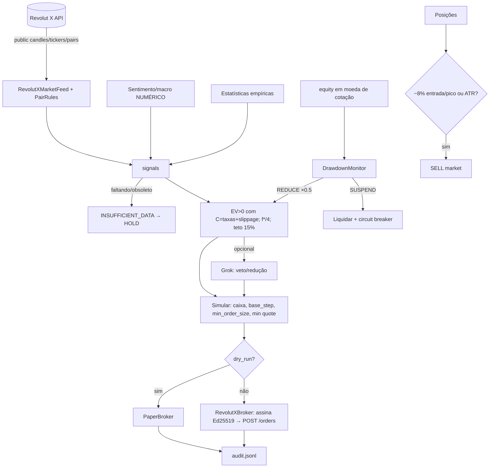

# Arquitetura (cripto / Revolut X)

| Módulo | Função |
|---|---|
| `config.py` | Parâmetros. Bloqueia Kelly≠0.25, teto acima de 15%, temperatura fora de 0.1–0.2 e intervalos de candle não aceitos pela API. `C = 2·(taker + slippage)` |
| `revolutx/client.py` | Cliente REST: assinatura Ed25519, rate limiting (token bucket), 429 com `Retry-After` em ms, retry em 5xx, limite diário de 1000 ordens |
| `revolutx/rules.py` | `base_step`/`quote_step`/`min_order_size`/`min_order_size_quote`/`max_order_size` com Decimal e arredondamento para baixo |
| `data.py` | `RevolutXMarketFeed`: `/public/candles` (descarta o candle ainda em formação) e `/public/tickers` (mid). Sentimento e estatísticas ficam como placeholders |
| `signals.py`, `indicators.py`, `sizing.py`, `risk.py`, `circuit.py` | Mesmas regras do PDF da versão de ações |
| `brokers/paper.py` | Simulação com quantidades fracionárias, taxa taker e slippage |
| `brokers/revolutx.py` | Broker real: `/balances`, `POST /orders` (market, `base_size`), cancelamento. Guarda a entrada e o pico de cada posição em `logs/revx_positions.json` |
| `engine.py` | Propor → Recuperar → Verificar → Simular (caixa, taxa, mínimos do par) → Executar |
| `llm.py`, `schema.py`, `system_prompt.xml` | Grok opcional, só pode vetar |

## Endpoints usados
| Uso | Endpoint | Auth | Rate limit (docs) |
|---|---|---|---|
| Regras dos pares | `GET /api/1.0/public/configuration/pairs` | não | 1 req/s |
| Preços | `GET /api/1.0/public/tickers?symbols=` | não | 1 req/s |
| OHLCV | `GET /api/1.0/public/candles/{symbol}?interval&since&until` | não | 1 req/s |
| Saldos | `GET /api/1.0/balances` | sim | 100/s, 1000/min |
| Ordens abertas | `GET /api/1.0/orders/active` (cursor) | sim | 100/s, 1000/min |
| Colocar ordem | `POST /api/1.0/orders` | sim | 10/s, 1000/dia |
| Cancelar | `DELETE /api/1.0/orders/{id}`, `DELETE /api/1.0/orders` | sim | 100/s, 1000/min |



## Backtest → ledger
```mermaid
flowchart LR
  P[/public/candles 100/página, 1 req/s/] --> C[cache data/candles_*.json]
  C --> SIM[simulate: technical_state igual ao live; entrada na abertura i+1; stops ATR/−8%; R bruto e líquido]
  SIM --> SPLIT{holdout cronológico 60/40}
  SPLIT --> IS[estatística IS]
  SPLIT --> OOS[estatística OOS → publicada]
  IS & OOS --> A[alpha = 1 − EV_oos/EV_is]
  OOS & A --> L[(data/signal_stats.json + generated_at + fingerprint)]
  L --> ST[SignalStatsStore: idade ≤ 7d, fingerprint igual, n ≥ 30, senão INSUFFICIENT_DATA]
  ST --> ENG[engine: p, b = avg_win/avg_loss, EV − C, f*/4·(1−α)]
```
